# EO tabele (ID, EX; SLO in ENG)

`out_eo_tabele` · workbook · TODO

Uporabniki: TODO

## Od kod pride

```mermaid
flowchart LR
  src_surs["src_surs<br/><small></small>"]:::source
  src_denis_place["src_denis_place<br/><small>DR</small>"]:::source
  platform_SURS["platform_SURS<br/><small>SURS tabele na platformi</small>"]:::store
  platform_UMAR_DR["platform_UMAR_DR<br/><small>tabele DR0xx na platformi</small>"]:::store
  umardata_DR["umardata_DR<br/><small>umar-data/DR/umar_serije_podatki_DR.xlsx</small>"]:::store
  out_eo_tabele["out_eo_tabele<br/><small>EO tabele (ID, EX; SLO in ENG)</small>"]:::output
  feed_place_DR["feed_place_DR<br/><small>task umar-add_data</small>"]:::step
  ingest_DR["ingest_DR<br/><small>task umar-add_data</small>"]:::step
  surs_import["surs_import<br/><small>task surs-update-database</small>"]:::step
  eo_04_place["eo_04_place<br/><small>task eo_tabele_update</small>"]:::step
  src_denis_place --> feed_place_DR
  feed_place_DR --> umardata_DR
  umardata_DR --> ingest_DR
  ingest_DR --> platform_UMAR_DR
  src_surs --> surs_import
  surs_import --> platform_SURS
  platform_SURS --> eo_04_place
  platform_UMAR_DR --> eo_04_place
  eo_04_place --> out_eo_tabele
  classDef source fill:#FAECE7,stroke:#993C1D
  classDef step fill:#F1EFE8,stroke:#5F5E5A
  classDef store fill:#E1F5EE,stroke:#0F6E56
  classDef output fill:#EEEDFE,stroke:#534AB7
```

## Viri

| Vir | Kdo | Kje | Kdaj pride |
|---|---|---|---|
| SiStat PX tabele | — | pxweb.stat.si | samodejno, po koledarju objav SURS |
| masa plač in prejemniki plač po SKD | DR | Users/DRogan/EO/Plače (nove SKD skupine).xlsx | Denis posodobi datoteko po objavi SURS (~45 dni po koncu meseca) |

## Taski

| Task | Kdaj | .bat | Log |
|---|---|---|---|
| [umar-add_data](task-umar-add_data.md) | dnevno 10:20, petek še 12:00, 13:00, 14:00 | `batch-scripts/umar-add_new_data.bat` | `logs/umar-data_update.log` |
| [surs-update-database](task-surs-update-database.md) | dnevno 10:32 | `batch-scripts/surs-update-database.bat` | `logs/surs-update-database.Rout` |
| [eo_tabele_update](task-eo_tabele_update.md) | petek 11:00 | `batch-scripts/eo_tabele_update.bat` | `logs/eo_tabele_update.Rout` |
