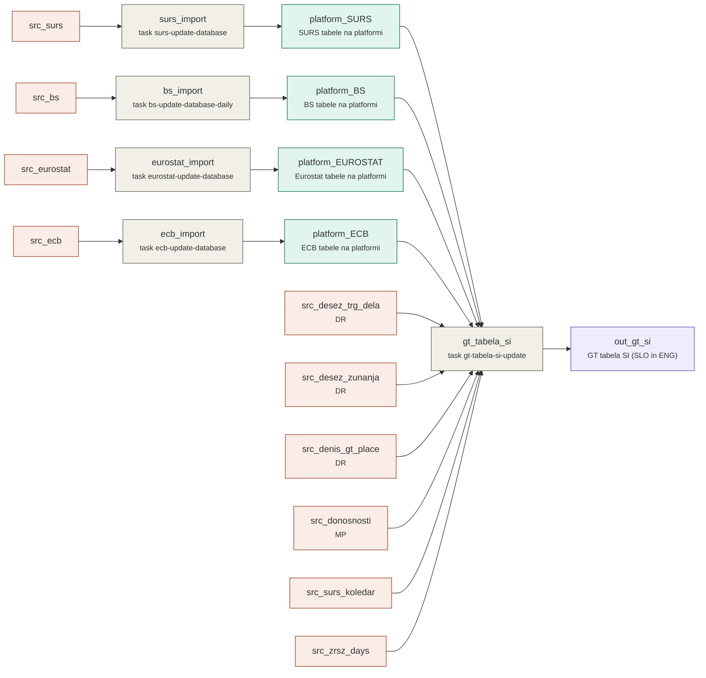

# GT tabela SI (SLO in ENG)

`out_gt_si` · workbook · data$/GT/GT_tabele_ZA WORD_ne spreminjaj/GT_tabela_SI_slo.xlsx, GT_tabela_SI_angl.xlsx

Uporabniki: UB, TNS, BBF

## Od kod pride

## Viri

| Vir | Kdo | Kje | Kdaj pride |
|---|---|---|---|
| desezonirani delovno aktivni, registrirani brezposelni, ILO | DR | DESEZONIRANJE/Trg dela/<serija>/Leto YYYY/MM/ | Denis desezonira podatke in jih odloži v mapo tekočega meseca |
| desezonirani realni izvoz in uvoz blaga | DR | DESEZONIRANJE/Zunanja trgovina/<serija>/Leto YYYY/MM/ | Denis desezonira podatke in jih odloži v mapo tekočega meseca |
| plače za GT tabelo | DR | Users/DRogan/GT/GT-place (REK).xlsx, list "tgg - tabela" | Denis posodobi datoteko |
| donosnosti 10-letnih obveznic | MP | data/donosnosti/Donosnosti_10Ya.xlsx, list Mesecno | Marjan ročno dopiše mesec |
| SURS koledar objav | — | stat.si ReleaseCalendarCsv | samodejno |
| datumi objav ZRSZ | — | R/gt-tabela-si-update.R, vektor zrsz_days (v kodi!) | ročno, enkrat letno s https://www.ess.gov.si/partnerji/trg-dela/koledar-objav/ |
| BS PX tabele | — | px.bsi.si | samodejno; BS objavlja nepravilno, zato tečemo dnevno |
| SiStat PX tabele | — | pxweb.stat.si | samodejno, po koledarju objav SURS |
| ECB Data Portal | — | data.ecb.europa.eu | samodejno |
| Eurostat API | — | ec.europa.eu/eurostat | samodejno |

## Taski

| Task | Kdaj | .bat | Log |
|---|---|---|---|
| [bs-update-database-daily](task-bs-update-database-daily.md) | dnevno 11:00 | `batch-scripts/bs-update-database-daily.bat` | `logs/bs-update-database-daily.Rout` |
| [surs-update-database](task-surs-update-database.md) | dnevno 10:32 | `batch-scripts/surs-update-database.bat` | `logs/surs-update-database.Rout` |
| [gt-tabela-si-update](task-gt-tabela-si-update.md) | petek 13:00 | `batch-scripts/gt-tabela-si-update.bat` | `logs/gt-tabela-si-update.Rout` |
| [ecb-update-database](task-ecb-update-database.md) | dnevno 10:00 | `batch-scripts/ecb-update-database.bat` | `logs/ecb-update-database.Rout` |
| [eurostat-update-database](task-eurostat-update-database.md) | dnevno 11:00 in 23:00 | `batch-scripts/eurostat-update-database.bat` | `logs/eurostat-update-database.Rout` |
