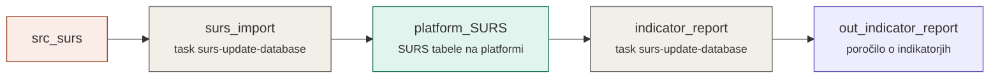

# poročilo o indikatorjih

`out_indicator_report` · report · TODO

Uporabniki: TODO

## Od kod pride

## Viri

| Vir | Kdo | Kje | Kdaj pride |
|---|---|---|---|
| SiStat PX tabele | — | pxweb.stat.si | samodejno, po koledarju objav SURS |

## Taski

| Task | Kdaj | .bat | Log |
|---|---|---|---|
| [surs-update-database](task-surs-update-database.md) | dnevno 10:32 | `batch-scripts/surs-update-database.bat` | `logs/surs-update-database.Rout` |
