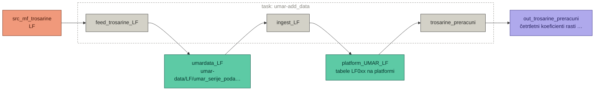

# četrtletni koeficienti rasti trošarin

`out_trosarine_preracuni` · workbook · Users/LFajic/trošarine/trošarine_preračuni.xlsx

Uporabniki: LF

## Od kod pride

## Viri

| Vir | Kdo | Kje | Kdaj pride |
|---|---|---|---|
| mesečni podatki o trošarinah | LF | data/trosarine/ (ročno odloženo) | MF pošlje datoteko, ki jo je treba ročno odložiti v mapo |

## Taski

| Task | Kdaj | .bat | Log |
|---|---|---|---|
| [umar-add_data](task-umar-add_data.md) | dnevno 10:20, petek še 12:00, 13:00, 14:00 | `batch-scripts/umar-add_new_data.bat` | `logs/umar-data_update.log` |
