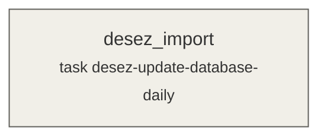

# Task desez-update-database-daily

| | |
|---|---|
| Task Scheduler | `\desez-update-database-daily` |
| Kdaj | dnevno 14:00 |
| .bat | `batch-scripts/desez_update_database.bat` |
| Log | `logs/desez_update.Rout` |
| Email (ime runa) | — |
| R | 4.5.2 |
| Teče po | — |
| Pred | — |
| Ponovni zagon | varen |

## Ponovni zagon

V Task Schedulerju desni klik na task › Run, ali poženi .bat. Izid je v logu zgoraj in v mailu bota.

## Koraki

