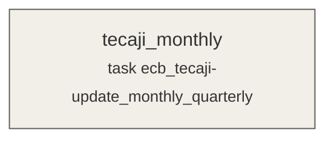

# Task ecb_tecaji-update_monthly_quarterly

| | |
|---|---|
| Task Scheduler | `\ecb_tečaji-update_monthly_quarterly` |
| Kdaj | enkratni sprožilci, zadnji 7. 12. 2026 |
| .bat | `batch-scripts/ecb_tečaji-monthly_quarterly_update.bat` |
| Log | `logs/tecaji-update_monthly_quarterly.Rout` |
| Email (ime runa) | — |
| R | 4.1.3 |
| Teče po | — |
| Pred | — |
| Ponovni zagon | varen |

## Ponovni zagon

V Task Schedulerju desni klik na task › Run, ali poženi .bat. Izid je v logu zgoraj in v mailu bota.

## Koraki

