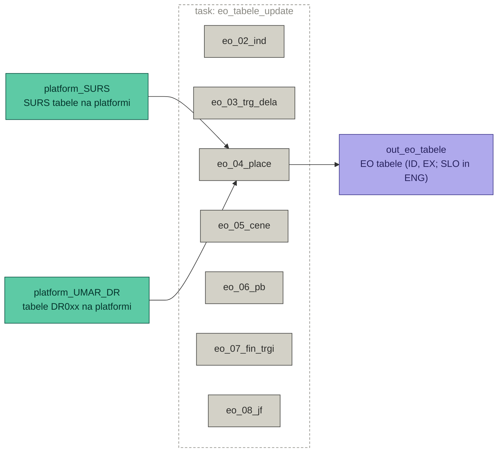

# Task eo_tabele_update

| | |
|---|---|
| Task Scheduler | `\eo_tabele_update` |
| Kdaj | petek 11:00 |
| .bat | `batch-scripts/eo_tabele_update.bat` |
| Log | `logs/eo_tabele_update.Rout` |
| Email (ime runa) | — |
| R | 4.1.3 |
| Teče po | surs-update-database, umar-add_data |
| Pred | — |
| Ponovni zagon | varen |

Teče vse skripte v R/tabele/ po abecedi; eo_00_setup.R je skupna.

## Ponovni zagon

V Task Schedulerju desni klik na task › Run, ali poženi .bat. Izid je v logu zgoraj in v mailu bota.

## Koraki

## Napaja

- [out_eo_tabele](output-out_eo_tabele.md)
