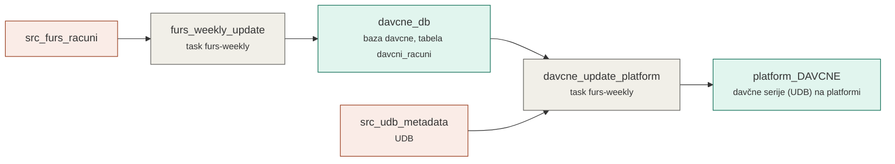

# Task furs-weekly

| | |
|---|---|
| Task Scheduler | `\furs-weekly` |
| Kdaj | sreda 08:15 |
| .bat | `batch-scripts/davcne-weekly-update.bat` |
| Log | `logs/furs_weekly_update.txt, logs/davcne_update_platform.txt` |
| Email (ime runa) | furs_weekly_update, davcne_update_platform |
| R | 4.5.2 |
| Teče po | — |
| Pred | — |
| Ponovni zagon | ponovni zagon pošlje heartbeat uporabnikom (Kušar, Koprivnikar, Kuštrin, Hazler) |

## Ponovni zagon

V Task Schedulerju desni klik na task › Run, ali poženi .bat. Izid je v logu zgoraj in v mailu bota.

## Koraki

