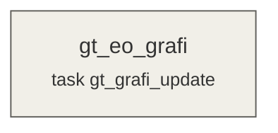

# Task gt_grafi_update

| | |
|---|---|
| Task Scheduler | `\gt_grafi_update` |
| Kdaj | dnevno 11:03, petek še 12:03, 13:03, 14:03 |
| .bat | `batch-scripts/gt_eo_grafi_update.bat` |
| Log | `logs/gt_grafi_update.Rout` |
| Email (ime runa) | — |
| R | 4.5.2 |
| Teče po | — |
| Pred | — |
| Ponovni zagon | varen |

## Ponovni zagon

V Task Schedulerju desni klik na task › Run, ali poženi .bat. Izid je v logu zgoraj in v mailu bota.

## Koraki

