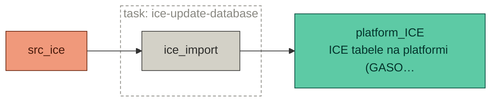

# Task ice-update-database

| | |
|---|---|
| Task Scheduler | `\ice-update-database` |
| Kdaj | dnevno 07:00 |
| .bat | `batch-scripts/ice-update-database.bat` |
| Log | `logs/ice-update-database.log` |
| Email (ime runa) | — |
| R | — |
| Teče po | — |
| Pred | — |
| Ponovni zagon | varen |

## Ponovni zagon

V Task Schedulerju desni klik na task › Run, ali poženi .bat. Izid je v logu zgoraj in v mailu bota.

## Koraki

