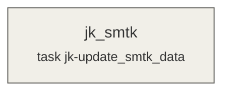

# Task jk-update_smtk_data

| | |
|---|---|
| Task Scheduler | `\jk-update_smtk_data` |
| Kdaj | dnevno 10:15 (samo ko je mzaloznik prijavljena!) |
| .bat | `batch-scripts/jk-update_smtk_data.bat` |
| Log | `logs/jk_update_smtk_data.Rout` |
| Email (ime runa) | — |
| R | 4.1.3 |
| Teče po | — |
| Pred | — |
| Ponovni zagon | varen |

## Ponovni zagon

V Task Schedulerju desni klik na task › Run, ali poženi .bat. Izid je v logu zgoraj in v mailu bota.

## Koraki

