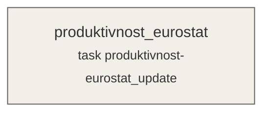

# Task produktivnost-eurostat_update

| | |
|---|---|
| Task Scheduler | `\produktivnost-eurostat_update` |
| Kdaj | enkratni sprožilci, zadnji 7. 12. 2026 |
| .bat | `batch-scripts/produktivnost-eurostat_update.bat` |
| Log | `logs/produktivnost-eurostat_update.Rout` |
| Email (ime runa) | — |
| R | 4.1.3 |
| Teče po | — |
| Pred | — |
| Ponovni zagon | varen |

## Ponovni zagon

V Task Schedulerju desni klik na task › Run, ali poženi .bat. Izid je v logu zgoraj in v mailu bota.

## Koraki

