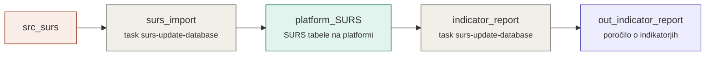

# Task surs-update-database

| | |
|---|---|
| Task Scheduler | `\surs-update-database` |
| Kdaj | dnevno 10:32 |
| .bat | `batch-scripts/surs-update-database.bat` |
| Log | `logs/surs-update-database.Rout` |
| Email (ime runa) | — |
| R | 4.1.3 |
| Teče po | — |
| Pred | eo_tabele_update |
| Ponovni zagon | varen |

## Ponovni zagon

V Task Schedulerju desni klik na task › Run, ali poženi .bat. Izid je v logu zgoraj in v mailu bota.

## Koraki

## Napaja

- [out_indicator_report](output-out_indicator_report.md)
- [out_eo_tabele](output-out_eo_tabele.md)
- [out_gt_si](output-out_gt_si.md)
