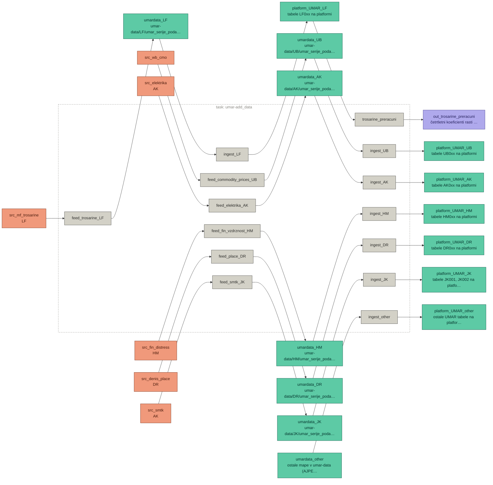

# Task umar-add_data

| | |
|---|---|
| Task Scheduler | `\umar-add_data` |
| Kdaj | dnevno 10:20, petek še 12:00, 13:00, 14:00 |
| .bat | `batch-scripts/umar-add_new_data.bat` |
| Log | `logs/umar-data_update.log` |
| Email (ime runa) | umar_data_update |
| R | 4.5.2 |
| Teče po | — |
| Pred | eo_tabele_update |
| Ponovni zagon | varen |

Feederji in uvoz posameznih map so neodvisni: napaka v enem pošlje ISSUES, ostali tečejo naprej. Logi uvoza po avtorjih: logs/UMARfetchR/.

## Ponovni zagon

V Task Schedulerju desni klik na task › Run, ali poženi .bat. Izid je v logu zgoraj in v mailu bota.

## Koraki

## Napaja

- [out_eo_tabele](output-out_eo_tabele.md)
- [out_trosarine_preracuni](output-out_trosarine_preracuni.md)
