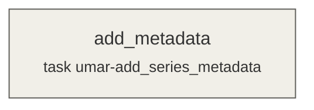

# Task umar-add_series_metadata

| | |
|---|---|
| Task Scheduler | `\umar-add_series_metadata` |
| Kdaj | ročno (inicialke avtorja v Actions / Add arguments) |
| .bat | `batch-scripts/umar-add_new_series_metadata.bat` |
| Log | `logs/umar-add_new_series_metadata.Rout` |
| Email (ime runa) | — |
| R | 4.1.3 |
| Teče po | — |
| Pred | — |
| Ponovni zagon | varen |

## Ponovni zagon

V Task Schedulerju desni klik na task › Run, ali poženi .bat. Izid je v logu zgoraj in v mailu bota.

## Koraki

